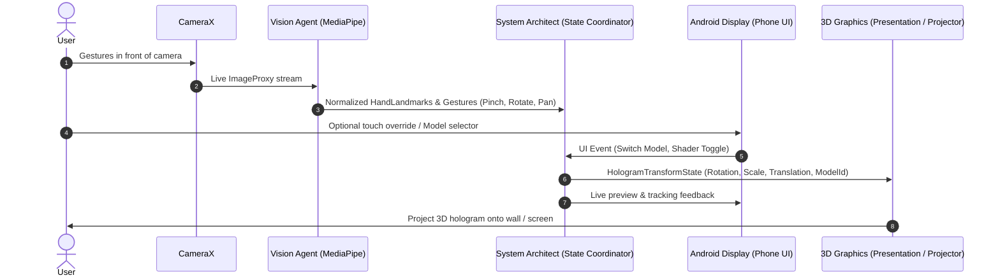

# DroidProjector - AI Agent Roster & Collaboration Framework

This document outlines the specialized agent hierarchy for **DroidProjector**, defining roles, domains of responsibility, interfaces, and collaboration protocols.

---

## 1. Agent Overview & Architecture

```
                  ┌──────────────────────────────┐
                  │       System Architect       │
                  │     (Orchestrator Agent)     │
                  └──────────────┬───────────────┘
                                 │
         ┌───────────────────────┼───────────────────────┐
         ▼                       ▼                       ▼
┌─────────────────┐     ┌─────────────────┐     ┌─────────────────┐
│ Android Display │     │   3D Graphics   │     │ Computer Vision │
│   Specialist    │     │   & Shaders     │     │   & Gestures    │
└─────────────────┘     └─────────────────┘     └─────────────────┘
```

Each agent has an in-depth specification in the [`.agents/`](file:///home/gianluca/Progetti/droidprojector/.agents) directory:

| Agent Role | Primary Focus | Key Technologies | Detailed Spec |
| :--- | :--- | :--- | :--- |
| **System Architect** | End-to-end design, data contracts, state coordination, milestone tracking | Kotlin Architecture, Flow/Coroutines, State Machine | [`.agents/architect.md`](file:///home/gianluca/Progetti/droidprojector/.agents/architect.md) |
| **Android Display Specialist** | Dual-display orchestration, `Presentation` API, CameraX lifecycle, UI controls | Android `DisplayManager`, `Presentation`, Jetpack Compose, CameraX | [`.agents/android_display.md`](file:///home/gianluca/Progetti/droidprojector/.agents/android_display.md) |
| **3D Graphics & Shaders Specialist** | Filament engine integration, glTF/GLB asset management, holographic shader pipeline | Google Filament, Sceneview, PBR materials, custom shaders | [`.agents/graphics_shader.md`](file:///home/gianluca/Progetti/droidprojector/.agents/graphics_shader.md) |
| **Computer Vision Specialist** | Real-time hand landmark tracking, gesture state machine, coordinate normalization | MediaPipe Tasks Vision (Hand Landmarker), OpenCV/Math utils | [`.agents/vision_gestures.md`](file:///home/gianluca/Progetti/droidprojector/.agents/vision_gestures.md) |

---

## 2. Interaction Contract & Data Flow



---

## 3. Delegation Guidelines

- **When modifying multi-display or camera setup**: Consult [Android Display Specialist](file:///home/gianluca/Progetti/droidprojector/.agents/android_display.md).
- **When adding or tuning 3D models and holographic visual shaders**: Consult [3D Graphics Specialist](file:///home/gianluca/Progetti/droidprojector/.agents/graphics_shader.md).
- **When adjusting gesture sensitivity, landmark smoothing, or gesture types**: Consult [Computer Vision Specialist](file:///home/gianluca/Progetti/droidprojector/.agents/vision_gestures.md).
- **When altering global application state, milestones, or interfaces**: Consult [System Architect](file:///home/gianluca/Progetti/droidprojector/.agents/architect.md).
