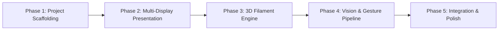

# DroidProjector - Master Project Plan & Roadmap

## 1. Executive Summary & Vision

**DroidProjector** is an Android application that transforms a modern smartphone into an interactive 3D holographic projection workstation. 

By leveraging standard external display connectivity (USB-C DisplayPort, HDMI, or Miracast), the phone projects a floating 3D holographic asset onto a screen, wall, or semi-reflective surface using pitch-black backgrounds (where black produces zero projected light). 

The smartphone's integrated camera (front or rear) tracks user hand and finger gestures in real time using Google MediaPipe, enabling touchless manipulation (rotation, scaling, panning, interaction) of the projected hologram in mid-air.

---

## 2. Technical Stack & Hardware Specification

- **Platform**: Android 8.0+ (`minSdk = 26`, `targetSdk = 35`, Kotlin 2.0+, Jetpack Compose)
- **Multi-Display Engine**: Android `DisplayManager` & `Presentation` API
- **3D Graphics Engine**: Google Filament (C++ PBR engine via Sceneview / Filament Kotlin bindings)
- **Computer Vision**: Google MediaPipe Tasks Vision (`HandLandmarker`)
- **Camera Pipeline**: AndroidX CameraX (Analysis + Preview with Front/Back switching)
- **Asset Format**: Standard glTF / GLB 2.0 with custom holographic materials (scanlines, rim glow)
- **Display Connection**: USB-C DisplayPort Alternate Mode, HDMI MHL/dongle, or Wireless Display (Miracast/Chromecast)

---

## 3. High-Level System Architecture

```
   ┌─────────────────────────────────────────────────────────────┐
   │                     Android Smartphone                      │
   │                                                             │
   │  ┌──────────────────┐               ┌──────────────────┐   │
   │  │ CameraX (Front/  │               │ Jetpack Compose  │   │
   │  │ Rear Sensor)     │               │ Phone UI Screen  │   │
   │  └────────┬─────────┘               └────────▲─────────┘   │
   │           │ ImageProxy                       │ Status &    │
   │           ▼                                  │ Controls    │
   │  ┌──────────────────┐               ┌────────┴─────────┐   │
   │  │ MediaPipe Hands  │──────────────▶│ Shared State /   │   │
   │  │ Landmarker       │ Normalized    │ Gesture Machine  │   │
   │  └──────────────────┘ Gestures      └────────┬─────────┘   │
   │                                              │ Matrix      │
   │                                              │ Transform   │
   │                                              ▼             │
   │                             ┌──────────────────────────┐   │
   │                             │ Android Presentation     │   │
   │                             │ (Secondary Display API)  │   │
   │                             └────────────┬─────────────┘   │
   │                                          │ Filament View   │
   └──────────────────────────────────────────┼─────────────────┘
                                              │ USB-C / HDMI / Wi-Fi
                                              ▼
                                 ┌──────────────────────────┐
                                 │    External Projector    │
                                 │   or Secondary Screen    │
                                 │ (Pure Black 3D Hologram) │
                                 └──────────────────────────┘
```

---

## 4. Implementation Phases & Milestones

The detailed execution tasks are broken down in the [`.plans/`](file:///home/gianluca/Progetti/droidprojector/.plans) directory:



| Phase | Milestone | Focus Areas | Detailed Document |
| :--- | :--- | :--- | :--- |
| **Phase 1** | [Scaffolding & Architecture](file:///home/gianluca/Progetti/droidprojector/.plans/phase1_project_scaffolding.md) | Gradle KTS setup, Jetpack Compose, CameraX & Filament dependencies, permissions, base layouts | [`.plans/phase1_project_scaffolding.md`](file:///home/gianluca/Progetti/droidprojector/.plans/phase1_project_scaffolding.md) |
| **Phase 2** | [Multi-Display Presentation](file:///home/gianluca/Progetti/droidprojector/.plans/phase2_presentation_display.md) | `DisplayManager.DisplayListener`, `Presentation` window lifecycle, auto-fallback to on-phone split-preview | [`.plans/phase2_presentation_display.md`](file:///home/gianluca/Progetti/droidprojector/.plans/phase2_presentation_display.md) |
| **Phase 3** | [3D Filament Engine & Shaders](file:///home/gianluca/Progetti/droidprojector/.plans/phase3_3d_filament_engine.md) | Filament / Sceneview integration, bundled sample models (Earth, Droid, Heart), custom holographic shader | [`.plans/phase3_3d_filament_engine.md`](file:///home/gianluca/Progetti/droidprojector/.plans/phase3_3d_filament_engine.md) |
| **Phase 4** | [Vision & Gesture Pipeline](file:///home/gianluca/Progetti/droidprojector/.plans/phase4_vision_gestures.md) | MediaPipe Hand Landmarker integration, pinch-to-zoom, palm rotation, swipe tracking, front/back switching | [`.plans/phase4_vision_gestures.md`](file:///home/gianluca/Progetti/droidprojector/.plans/phase4_vision_gestures.md) |
| **Phase 5** | [Integration, Testing & Polish](file:///home/gianluca/Progetti/droidprojector/.plans/phase5_integration_refinement.md) | End-to-end event loop, lag smoothing / jitter reduction, memory optimization, simulated secondary display testing | [`.plans/phase5_integration_refinement.md`](file:///home/gianluca/Progetti/droidprojector/.plans/phase5_integration_refinement.md) |

---

## 5. Verification & Testing Strategy

1. **Dual Mode Fallback**: When no physical projector is connected, the phone displays a Picture-in-Picture / Split-Screen view showing both the camera tracker and the 3D hologram.
2. **Android Emulator / Developer Options**:
   - Enable `Settings > Developer Options > Simulate secondary displays` (e.g. 1080p secure display) to test `Presentation` on any standard Android device or emulator without a physical projector.
3. **Physical Hardware Validation**:
   - Plug in USB-C to HDMI adapter or connect to a smart TV/projector via Miracast/Chromecast.
   - Verify that UI controls stay on phone while clean 3D visuals route to the external projector.
